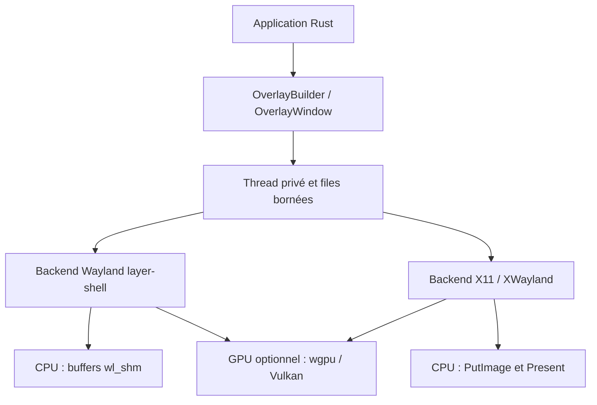

# Architecture

`liboverlay-rs` fournit l'infrastructure d'une fenêtre d'overlay Linux. L'application
fournit les données et le dessin ; la bibliothèque prend en charge la création de
surface, la transparence, l'entrée, les connexions graphiques et la présentation.

## API et runtime

`OverlayBuilder` définit les dimensions, l'écran, l'ancrage, la transparence,
l'entrée et les préférences de backend et de renderer. `build()` valide la
configuration puis démarre le thread qui possède les connexions graphiques.

`OverlayWindow` est un handle clonable `Send + Sync`. Les commandes et les frames
passent par une file bornée à huit entrées. Le runtime garde au plus une frame en
attente et peut la remplacer par une plus récente. La file d'événements comporte
au plus 256 entrées ; les mouvements successifs sont fusionnés. Cette organisation
limite l'accumulation lorsque l'application dessine plus vite que l'affichage.

Le thread traite les commandes d'entrée même si une frame attend son tour.
`close()` demande l'arrêt et joint le thread. Le dernier handle détruit demande
également le nettoyage. Les fonctions de dessin GPU s'exécutent sur ce thread et
doivent rester courtes ; les commandes synchrones depuis ces fonctions sont refusées.

## Sélection du backend

En mode `Auto`, la présence de `WAYLAND_DISPLAY` ou `WAYLAND_SOCKET` conduit à
essayer Wayland. La connexion et les protocoles requis sont réellement vérifiés.
Si cette tentative échoue et que `DISPLAY` est disponible, le runtime essaie X11.
Le rapport conserve la raison des échecs précédents.

`WaylandOnly` et `X11Only` empêchent ce repli. Une perte de connexion après création
ferme la fenêtre ; aucune migration automatique d'une fenêtre vivante n'est fournie.

## Wayland

Le backend crée une surface `wlr-layer-shell` dans la couche Overlay. La région
d'entrée vide laisse passer les clics ; restaurer la région par défaut rend la
surface interactive. Le clavier reste désactivé par défaut.

Le profil CPU utilise des buffers ARGB prémultipliés en mémoire partagée. Au plus
trois buffers coexistent, toutes générations confondues. Un buffer occupé ne peut
être réécrit avant `wl_buffer.release`. Les callbacks de frame règlent la cadence.

Lorsque fractional-scale et viewporter sont présents ensemble, les dimensions
physiques sont calculées à partir du facteur exact en 120ᵉ. Sinon, l'échelle
entière des sorties est utilisée. Un changement de géométrie incrémente la
génération ; les frames obsolètes sont abandonnées.

## X11 et XWayland

Le backend utilise `x11rb::RustConnection` sur une socket Unix locale. Il négocie
un visual ARGB avec RENDER et vérifie la composition. Les régions SHAPE INPUT
permettent la bascule des clics. L'empilement dépend du gestionnaire de fenêtres
et du compositeur ; les modes disponibles sont décrits dans le rapport.

Le rendu CPU transfère les pixels par `PutImage`. Avec Present, une copie est
planifiée pour le prochain intervalle vertical et le pixmap attend les notifications
de fin et de libération avant réutilisation. Sans Present, un timer règle la cadence.

## Vulkan optionnel

La feature `gpu` ajoute des swapchains Vulkan pilotées par wgpu. Le renderer
sélectionne un adaptateur, vérifie les formats, le mode alpha et FIFO. Le mode
GPU préféré peut revenir au CPU ; le mode GPU obligatoire échoue si une exigence
n'est pas satisfaite. Une surface opaque n'est acceptée qu'avec une exigence de
transparence relâchée explicitement.

Une instance Vulkan est initialisée une fois par processus et partagée entre les
fenêtres. Chaque fenêtre possède sa surface et son périphérique. Le cache conserve
des ressources natives pendant la vie du processus. Les ressources applicatives
du périphérique peuvent survivre à la fermeture de la fenêtre.

Les images commencent transparentes. Le callback reçoit une vue, un encodeur et
la géométrie courante ; ses commandes sont soumises directement au GPU, sans
lecture des images vers le CPU. Les surfaces sont détruites avant les objets
natifs qui leur servent de support.

Le profil GPU charge dynamiquement Vulkan et, selon le backend, libwayland-client
ou libxcb. Le profil CPU sans `gpu` conserve ses transports Rust et la possibilité
de produire des exécutables musl statiques.

## Organisation des sources

| Fichier | Responsabilité |
|---|---|
| `src/lib.rs` | Exports publics et documentation de la crate |
| `src/builder.rs` | Configuration et validation avant démarrage |
| `src/runtime.rs` | Handles, commandes, événements et cycle de vie du thread |
| `src/backend/mod.rs` | Interface interne et sélection des backends |
| `src/backend/wayland.rs` | Protocoles Wayland, buffers et géométrie |
| `src/backend/x11.rs` | Fenêtres X11, entrée, pixels et Present |
| `src/gpu.rs` | Contexte GPU et présentation Vulkan optionnelle |
| `src/render.rs` | Frames CPU, alpha, tailles et facteurs d'échelle |
| `src/capabilities.rs` | Rapport de capacités et informations du renderer |
| `src/events.rs`, `src/error.rs` | Événements publics et erreurs typées |
