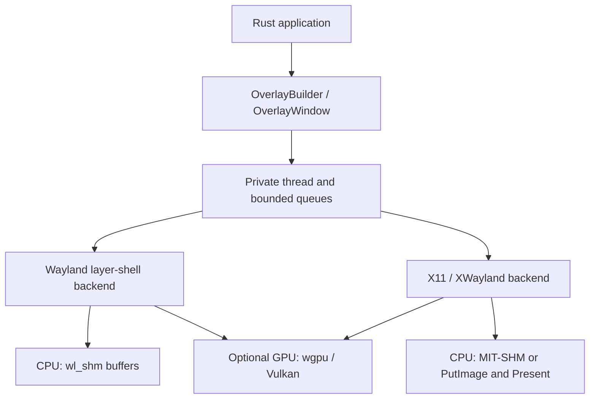

# Architecture

`liboverlay-rs` provides the infrastructure for a Linux overlay window. The
application supplies its data and drawing; the library handles surface creation,
transparency, input, display connections and presentation.

## API and runtime

The optional `egui` feature adds `EguiOverlay` without a second window:
egui-wgpu encodes on the same device and surface. The local `liboverlay-c`
package adds a C boundary with copied data, a generic drawing/widget command
API and a sample application interface. C++ retains control of settings. This
API is confined to its creating thread, while `OverlayWindow` retains its
`Send + Sync` contract. The bridge's contracts and limitations are described in
[CPP.md](CPP.md).

`OverlayBuilder` defines dimensions, output, anchoring, transparency, input and
backend/renderer preferences. `build()` validates the configuration, then starts
the thread that owns the display connections.

`OverlayWindow` is a clonable `Send + Sync` handle. Commands and frames pass
through a bounded queue with eight entries. The runtime keeps at most one pending
frame and may replace it with a newer one. The event queue holds at most 256
entries; consecutive motion events are coalesced. This limits accumulation when
the application draws faster than the display. Public queue overflow produces
an observable reset with an explicit scope (keyboard, touch or all input); the
backend also resets its internal tracking. Key and contact states are bounded.

The thread processes input commands even while a frame is waiting. `close()`
sets a stop flag and wakes the thread directly, bypassing the drawing queue.
Concurrent close calls wait for the same thread. Dropping the last handle also
requests cleanup. GPU drawing callbacks run on this thread and must remain short;
synchronous commands from those callbacks are rejected. Callbacks can capture a
`WeakOverlayWindow`, obtained with `downgrade()`, to reference the window without
retaining its last owner while presentation is pending.

The runtime recycles at most two CPU frame allocations. A reused allocation
receives the current generation and zeroed pixels. The cache is cleared at
shutdown; frames still held by the application remain its responsibility. Fatal
errors are consumed once through the shared queue.

## Backend selection

In `Auto` mode, `WAYLAND_DISPLAY` or `WAYLAND_SOCKET` causes a Wayland attempt.
The connection and required protocols are checked. If that attempt fails and
`DISPLAY` is available, the runtime tries X11. The report retains the reasons
for previous failures.

`WaylandOnly` and `X11Only` prevent this fallback. Losing a connection after
creation closes the window; a live window is not automatically migrated.

## Wayland

The backend creates a `wlr-layer-shell` surface in the Overlay layer. An empty
input region passes clicks through; restoring the configured region makes the
surface interactive. Keyboard input is disabled by default.

The CPU profile uses premultiplied ARGB buffers in shared memory. At most three
buffers coexist across all generations. A busy buffer cannot be rewritten before
`wl_buffer.release`. Frame callbacks control pacing.

When fractional-scale and viewporter are both present, physical dimensions are
calculated from the exact scale factor in 120ths. Otherwise, the integer output
scale is used. Geometry changes increment the generation; outdated frames are
discarded.

## X11 and XWayland

The backend uses `x11rb::RustConnection` over a local Unix socket. It negotiates
an ARGB visual with RENDER and checks compositing. SHAPE INPUT regions support
click-through switching. Stacking depends on the window manager and compositor;
the report describes the available modes.

With on-demand keyboard input, the window is managed by the WM. It requests no
decorations and supplies position and size hints. `_NET_WM_USER_TIME=0` requests
that opening the window preserve focus, following
[EWMH](https://specifications.freedesktop.org/wm/latest-single/). Real key or
button presses subsequently update this timestamp. These hints remain subject
to the window manager's policy.

CPU rendering negotiates MIT-SHM 1.2 and transfers a memfd sealed against
resizing. The server receives a read-only view. A `ShmCompletion` notification
makes the buffer reusable. Without this path, pixels travel through `PutImage`
requests split according to the server's maximum request size. With Present,
a copy is scheduled for the next vertical interval and the pixmap waits for
completion and idle notifications before reuse. Without Present, a timer
controls pacing.

The backend tracks RandR events and root-window `ConfigureNotify` events. The
latter also cover monitor definitions that do not change the overall screen
size. It recalculates anchoring and `Fill` dimensions, then lets the overlay's
`ConfigureNotify` confirm its new geometry. Losing a named monitor closes the
window; automatic selection follows the primary or first available monitor.

## Input translation and composition

`src/input` contains the shared contracts, the kbvm XKB/Compose engine and bounded
contact tracking. Backends supply keymaps, modifier states, focus transitions and
touch events. Keyboard resets do not remove contacts from an unrelated device.

Wayland has a keyboard, touch tracking and optionally a text-input-v3 context
per seat. Text batches are exposed in protocol order. X11 tracks XKB, negotiates
XI2 and uses a shared connection on the same thread for XIM. XIM keys wait to be
returned or consumed without reordering presses and releases. Synchronization
and reset exchanges have queue limits and deadlines; an input-method failure
leaves rendering and the local input path available.

These modules do not store the application's document. The
[input contract](INPUT_DESIGN.md) defines preedit, commit, deletion and
interruption notifications. Dependencies on this path are written in Rust and
preserve the musl CPU profile.

## Damage and timestamps

Optional CPU damage tracking retains the last accepted image and calculates a
bounding box around its differences. It runs after backend readiness checks so
that it remains independent of frames replaced in the queue. The X11 server
receives subimages; Wayland buffers that change slots are fully restored before
partial damage is applied. Size and generation changes invalidate the cache.
Without this option, no comparison image is allocated.

Presentation feedback is separate from queuing and submission. Wayland limits
its feedback objects to 64, releasing them on presentation or discard. Locally
produced events are delivered before waiting on sockets, including for an
identical frame that causes no repaint. X11 associates completion with its
Present serial number and submitted generation. Tracking is disabled by default
and does not claim to measure a panel's pixel response.

## Optional Vulkan rendering

The `gpu` feature adds Vulkan swapchains managed by wgpu. The renderer selects an
adapter and checks formats, alpha mode and FIFO. GPU-preferred mode can fall
back to the CPU; GPU-required mode fails when a requirement is unmet. An opaque
surface is accepted only when the transparency requirement is explicitly relaxed.

A Vulkan instance is initialized once per process and shared between windows.
Each window has its own surface and device. The cache retains native resources
for the process lifetime. Application-owned device resources can outlive the
window.

Images start transparent. The callback receives a view, an encoder and the
current geometry; its commands are submitted directly to the GPU without reading
images back to the CPU. Surfaces are destroyed before their native backing
objects.

The panic recovery boundary keeps the surface image outside callback unwinding.
It can therefore be discarded normally before swapchain destruction. With
`panic=unwind`, a panic becomes `RuntimePanic` and closes the runtime.
`panic=abort` does not permit this recovery. If the device becomes invalid while
an image is acquired, the runtime also protects presentation and discard of that
image. It retains a cleanup handle to release the resource before surface
destruction. A periodic 250 ms check monitors the device even without drawing
or while Wayland callbacks are withheld. This wait does not artificially resume
presentation of a hidden surface.

The GPU profile dynamically loads Vulkan and, depending on the backend,
libwayland-client or libxcb. The CPU profile without `gpu` retains its Rust
transports and the ability to build static musl executables.

## Source organization

| File | Responsibility |
|---|---|
| `src/lib.rs` | Public exports and crate documentation |
| `src/builder.rs` | Configuration and validation before startup |
| `src/runtime.rs` | Handles, commands, events and thread lifecycle |
| `src/backend/mod.rs` | Internal interface and backend selection |
| `src/backend/wayland.rs` | Wayland protocols, buffers and geometry |
| `src/backend/x11.rs` | X11 windows, input, pixels and Present |
| `src/damage.rs` | CPU comparison, cache invalidation and change bounds |
| `src/presentation.rs` | Clocks and presentation notification quality |
| `src/backend/wayland/presentation.rs` | Bounded presentation-time object tracking |
| `src/input/` | Regions, UTF-8 context, XKB/Compose translation and contacts |
| `src/backend/wayland/input.rs` | Seats, keyboard, touch and text-input-v3 |
| `src/backend/x11/keyboard.rs` | XKB negotiation, keymaps and layout changes |
| `src/backend/x11/ime.rs` | XIM, preedit and key synchronization |
| `src/backend/x11/touch.rs` | XInput 2.2 and contact cancellation |
| `src/backend/x11/shm.rs` | X11 shared memory and upload synchronization |
| `src/backend/x11/connection.rs` | Local connection, authentication and X11 deadlines |
| `src/backend/x11/geometry.rs` | Monitor selection and placement calculations |
| `src/backend/x11/pacing.rs` | Present notification state and pixmap reuse |
| `src/runtime/tests.rs` | Concurrency, queue, recycling and cleanup contracts |
| `src/gpu.rs` | GPU context and optional Vulkan presentation |
| `src/render.rs` | CPU frames, alpha, dimensions and scale factors |
| `src/capabilities.rs` | Capability report and renderer information |
| `src/events.rs`, `src/error.rs` | Public events and typed errors |

Validation scripts create their own sockets, servers and outputs. Test proxies
forward Unix file descriptors and hide only the capabilities or callbacks needed
by each scenario. Tests do not infer that a capability is absent from an
environment variable alone.
